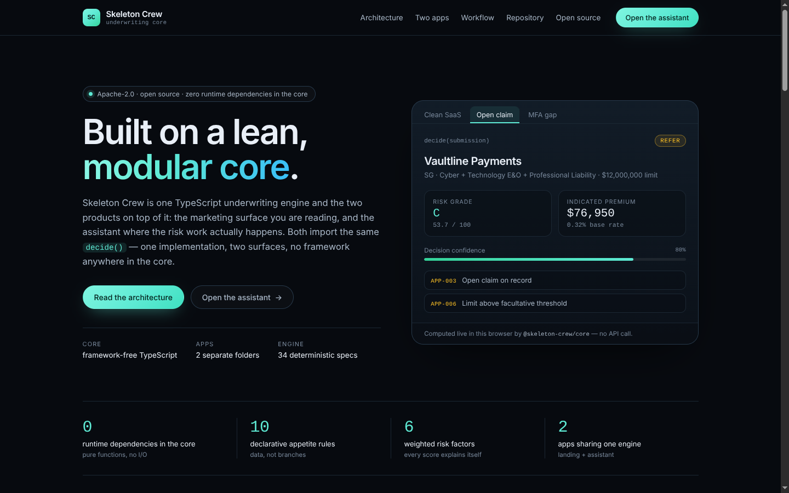
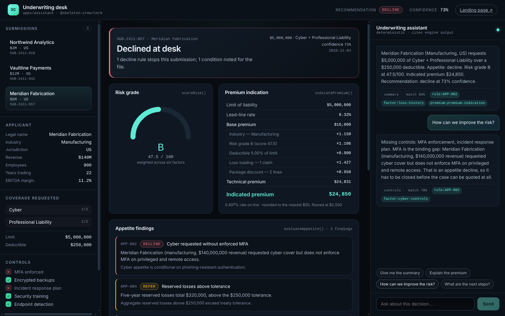
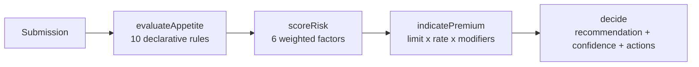

<div align="center">

# Skeleton Crew

**A lean, modular underwriting core — one engine powering a marketing site and an underwriting assistant.**

[](LICENSE)
[](https://github.com/haunguyenht/skeleton-crew/actions/workflows/ci.yml)
[](packages/core/test)
[](packages/core/package.json)



</div>

---

## What this is

Skeleton Crew is a commercial underwriting engine and the two products built on it. The engine
takes a submission — applicant, coverage request, security controls, five-year loss run — and
returns a decision: appetite status, risk grade, premium indication, confidence and the actions the
desk takes next.

It is deliberately boring in the places that matter: pure functions, no I/O, no clock, no
framework, no hidden state. Every number the interface shows is a field on the object the core
returned, which is why the assistant can explain a decision without inventing anything.

```
apps/landing      →  imports @skeleton-crew/core  →  renders a live decision in the hero
apps/assistant    →  imports @skeleton-crew/core  →  runs the whole desk workflow
```

## Two apps, one dependency direction

| Folder           | What it is                                                                                       | Dev                         |
| ---------------- | ------------------------------------------------------------------------------------------------ | --------------------------- |
| `apps/landing`   | Marketing site. Positioned, diagrammed, and honest: the hero decision card is computed in-browser. | `pnpm dev:landing` (:5173)  |
| `apps/assistant` | Underwriting console. Submission, decision and a grounded assistant, three columns, no API calls.  | `pnpm dev:assistant` (:5174) |

Both are static Vite builds. Neither contains underwriting logic — a rule change lands in both
products at once, which is the entire point of the layout.



## Quick start

```bash
pnpm install
pnpm dev            # landing on :5173, assistant on :5174
```

Other useful commands:

```bash
pnpm test           # 34 engine specs (vitest)
pnpm typecheck      # every package
pnpm build          # both apps to apps/*/dist
```

Requires Node 20.11+ and pnpm 10.

## The engine in one call

```ts
import { decide, SAMPLE_SUBMISSIONS } from "@skeleton-crew/core";

const decision = decide(SAMPLE_SUBMISSIONS[1]); // Vaultline Payments

decision.appetite.status;              // "refer"
decision.risk.grade;                   // "C"
decision.risk.score;                   // 53.7
decision.premium.suggestedPremiumUsd;  // 76950
decision.appetite.findings[0].ruleId;  // "APP-003"
decision.nextActions[0];               // "Route APP-003 to claims review before any indication is released."
```

`decide()` is four pure steps in a fixed order:



Appetite and risk stay separate on purpose: an account can score well and still be uninsurable
under delegated authority. Meridian Fabrication in the sample data is exactly that — risk grade B,
declined at desk because cyber cover was requested without enforced MFA.

## Repository layout

```
skeleton-crew/
├── .kiro/                     # Kiro context — public, deliberately not ignored
│   ├── steering/              # product, tech and structure guidance
│   └── specs/                 # requirements, design and tasks per feature
├── apps/
│   ├── landing/               # marketing site (Vite + React + TS)
│   └── assistant/             # underwriting console (Vite + React + TS)
├── packages/
│   └── core/                  # the engine — zero runtime dependencies
│       ├── src/
│       │   ├── domain/        # types and rate tables
│       │   ├── appetite/      # rulebook + evaluator
│       │   ├── scoring/       # weighted risk factors
│       │   ├── pricing/       # premium indication
│       │   ├── assistant/     # AssistantPort + grounded implementation
│       │   ├── samples/       # three worked submissions
│       │   └── engine.ts      # decide()
│       └── test/              # 34 specs
├── docs/
│   ├── architecture.md        # module contracts, diagrams, extension recipes
│   └── screenshots/
├── LICENSE                    # Apache-2.0
├── pnpm-workspace.yaml
└── README.md
```

## The core

| Module          | Responsibility                                                                                      |
| --------------- | --------------------------------------------------------------------------------------------------- |
| `domain`        | One shared vocabulary: `Submission`, `Applicant`, `CoverageRequest`, `ClaimRecord`, `Decision`.       |
| `appetite`      | Ten rules, each with severity, rationale and evidence. Adding appetite is a data change.             |
| `scoring`       | Six weighted factors → 0–100 score and a grade. Every factor carries the sentence that explains it.  |
| `pricing`       | Technical and indicated premium; every modifier is returned in the breakdown.                        |
| `assistant`     | `AssistantPort` plus a deterministic, citation-backed implementation. Swap in a model, change nothing. |
| `engine`        | `decide()` composes the four steps and derives confidence and desk actions.                          |

Because the core has no runtime dependencies, it runs unchanged in Node, in a browser, inside a
worker, or behind a server-side review queue. See [docs/architecture.md](docs/architecture.md) for
module contracts, the decision sequence and the recipes for adding a rule, a factor or an assistant
provider.

## The assistant is a port, not a prompt

`AssistantPort` is one method:

```ts
ask(question: string, context: { submission; decision }): Promise<AssistantReply>
```

`GroundedAssistant` implements it by composing sentences strictly from the decision it was handed,
and returning `citations` that point at rule ids, factor ids and the premium indication. It runs
offline, in tests, and in the browser. A hosted model can replace it behind the same interface
without either app changing a line — the citations are the contract.

## Design decisions

- **No build step for the core.** It ships as TypeScript source; Vite and Vitest consume it
  directly. `pnpm build` on the core is a typecheck, and typechecking is the build.
- **Determinism over convenience.** `decide()` takes an optional `decidedAt` so a decision can be
  replayed and asserted. No `Date.now()` leaks into an assertion.
- **Boring state.** The assistant app holds one hook (`useDecision`) with the selected submission.
  Everything else is derived.
- **Explainability as a type.** Findings, factors and modifiers all carry their own prose. The UI
  never writes an explanation; it renders one.

## Testing

```bash
pnpm test
```

```
test/appetite.test.ts   ( 8 tests)  rule coverage, ordering, purity
test/scoring.test.ts    ( 7 tests)  weights, bands, monotonicity, rationales
test/pricing.test.ts    ( 7 tests)  base maths, credits, floor, rounding
test/engine.test.ts     ( 6 tests)  recommendations, routing, determinism, confidence
test/assistant.test.ts  ( 6 tests)  intents, citations, no NaN/undefined ever
```

## Built with Kiro

The `.kiro/` folder at the repository root holds the steering documents (product, tech, structure)
and the spec for the underwriting assistant (requirements, design, tasks). It is intentionally not
gitignored: the reasoning behind the code travels with the code.

## Deployment

Both apps are static. `pnpm build` emits `apps/landing/dist` and `apps/assistant/dist`, and each
build works from a sub-path (`base: "./"`), so GitHub Pages or any bucket will serve them. The
landing page reads two optional environment variables at build time:

```bash
VITE_ASSISTANT_URL=https://desk.example.com pnpm build
VITE_LANDING_URL=https://example.com pnpm build --filter @skeleton-crew/assistant
```

## License

[Apache-2.0](LICENSE) © Skeleton Crew contributors.
