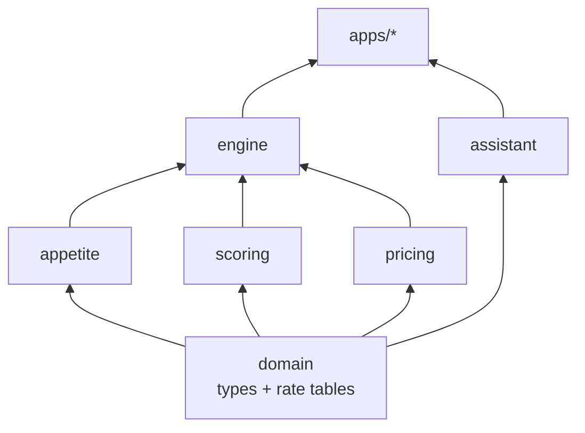
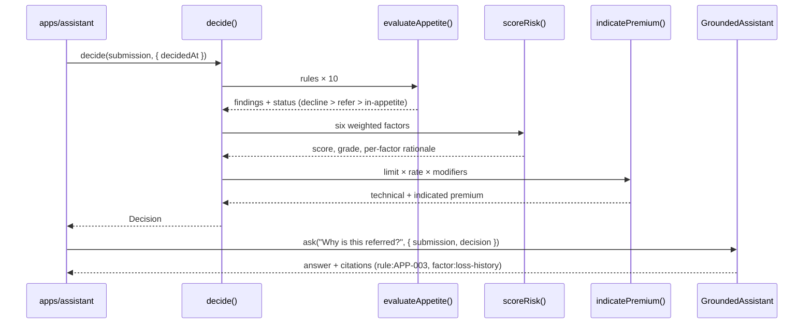
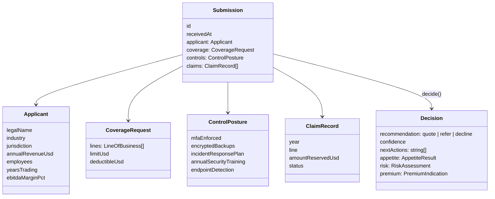
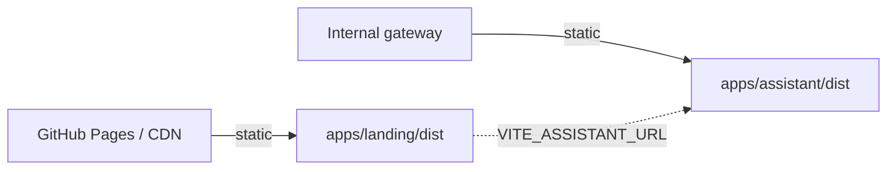

# Architecture

Skeleton Crew is two applications over one engine. This document records the module boundaries, the
contract each module owes its callers, and the recipes for extending the engine without touching
either app.

## 1. System context

```mermaid
graph TD
    Broker[Broker / producer] -->|submission JSON| Desk
    subgraph Desk[Skeleton Crew]
        Landing[apps/landing<br/>marketing site]
        Assistant[apps/assistant<br/>underwriting console]
        Core[packages/core<br/>underwriting engine]
        Landing -->|decide()| Core
        Assistant -->|decide() / AssistantPort| Core
    end
    Desk -->|decision + citations| UW[Underwriter]
    UW -->|bind, decline, or refer| Broker
```

There is no server component. The core is a pure library, so every deployment is a static build of
an app plus the same compiled engine inside it.

## 2. Layering and the dependency rule



The rule is one-directional: **apps depend on the core, the core depends on nothing.**
`packages/core/package.json` has no `dependencies` block at all. If a change requires the core to
know about React, the DOM, `fetch` or a clock, the change belongs in an app instead.

## 3. Module contracts

| Module       | Entry point                                                  | Contract                                                                 |
| ------------ | ------------------------------------------------------------ | ------------------------------------------------------------------------ |
| `domain`     | `src/domain/types.ts`, `src/domain/constants.ts`             | Types only. Rate tables and thresholds are data, not logic.               |
| `appetite`   | `evaluateAppetite(submission): AppetiteResult`               | Pure, total, order-stable. Findings sorted decline → refer → note.        |
| `scoring`    | `scoreRisk(submission): RiskAssessment`                      | Weights sum to 1. `score` equals the weighted sum of `factors`.          |
| `pricing`    | `indicatePremium(submission, risk): PremiumIndication`       | Returns every modifier. Never below `MIN_PREMIUM_USD`.                   |
| `assistant`  | `AssistantPort.ask(question, context)`                       | Answered only from `context`. Citations name rule, factor or premium ids. |
| `engine`     | `decide(submission, options?): Decision`                     | Composition of the four above plus confidence and desk actions.           |

### Invariants worth protecting

1. `scoreRisk` weights sum to exactly 1 — the composite score stays on a 0–100 scale.
2. `evaluateAppetite` never mutates its input and is stable across calls.
3. `indicatePremium` rounds the indicated premium to a $50 step and never goes below $2,500.
4. `decide` accepts `decidedAt`, so a decision can be replayed byte-for-byte.
5. The assistant never emits `undefined` or `NaN`; a spec asserts this across every intent.

## 4. Decision sequence



## 5. Data model



## 6. Appetite rulebook

| Rule    | Severity | Bites when                                              |
| ------- | -------- | ------------------------------------------------------- |
| APP-001 | decline  | Jurisdiction is outside delegated authority              |
| APP-002 | decline  | Cyber requested without enforced MFA                     |
| APP-003 | refer    | An open claim is on the loss run                         |
| APP-004 | refer    | Reserved losses exceed $250,000                          |
| APP-005 | refer    | Trading history under two years                          |
| APP-006 | refer    | Limit above the $10,000,000 facultative threshold        |
| APP-007 | refer    | EBITDA margin is zero or negative                        |
| APP-008 | note     | Cyber requested with no incident response plan           |
| APP-009 | refer    | Revenue above $250,000,000 (large account)               |
| APP-010 | note     | Cyber deductible below 2.50% of limit                    |

A rule returns an **evidence sentence** or `null`. That sentence is what the desk quotes to the
broker, so the rulebook replaces the memo, not just the spreadsheet.

## 7. Scoring model

| Factor              | Weight | Input                                                     |
| ------------------- | ------ | --------------------------------------------------------- |
| Cyber controls      | 28%    | Weighted coverage of five control families                |
| Loss history        | 24%    | Open claims and reserved dollars                          |
| Financial strength  | 16%    | EBITDA margin bands                                       |
| Industry volatility | 14%    | Benchmark per industry                                    |
| Trading maturity    | 10%    | Years trading bands                                       |
| Coverage stretch    | 8%     | Limit ÷ revenue, plus a thin-retention penalty            |

Grade bands: `< 20` A+, `< 35` A, `< 50` B, `< 65` C, otherwise D. Lower is better.

## 8. Pricing formula

```
leadRate        = max(rate for requested lines)          // the lead line sets the rate
basePremium     = limit × leadRate
technical       = basePremium
                  × industry multiplier
                  × (0.75 + score/100 × 0.75)            // 0.75 – 1.50
                  × clamp(1 − 2 × deductibleRatio, 0.7, 1)
                  × (1 + min(0.6, openClaims×0.15 + reserved/750k))
                  × (0.95 if more than one line else 1)
indicated       = max(2_500, round(technical, 50))
```

Worked example (Vaultline Payments, sample 2): $12M limit at 0.32% = $38,400 base; modifiers
1.35 × 1.153 × 0.975 × 1.39 × 0.95 = 2.0035 → technical $76,942 → indicated $76,950.

## 9. The assistant port

```ts
export interface AssistantPort {
  ask(question: string, context: AssistantContext): Promise<AssistantReply>;
}
```

`GroundedAssistant` scores the question against six intents (premium, controls, next steps, risk
drivers, appetite, summary), composes the answer from `context.decision`, and returns citations.
Its confidence describes **intent match**, not model certainty; the decision's own confidence is a
separate number and both are shown in the UI so they are never confused.

To swap providers, implement `AssistantPort` against a hosted model, inject the decision into the
prompt as structured context, and keep the citations. No app code changes.

## 10. Determinism and testing

- Everything in the core is a pure function over plain data.
- `decide(submission, { decidedAt })` makes time an input.
- Tests assert behaviour, not snapshots: weights sum to one, stronger controls score lower, a
  riskier account prices higher, a thin limit hits the premium floor, the assistant never emits
  `undefined`.
- Sample submissions double as fixtures, so demo data and test data cannot drift apart.

## 11. Extension recipes

**Add an appetite rule** — one entry in `packages/core/src/appetite/rules.ts`:

```ts
{
  id: "APP-011",
  title: "Crypto treasury exposure",
  rationale: "Digital-asset treasury risk sits outside current treaty terms.",
  severity: "refer",
  evaluate: ({ applicant }) =>
    applicant.industry === "fintech" && applicant.annualRevenueUsd > 500_000_000
      ? "Treasury exposure above the digital-asset tolerance."
      : null,
}
```

**Add a scoring factor** — add the id to `RiskFactorId`, give it a weight in `FACTOR_WEIGHTS`
(keep the sum at 1), and push one more entry in `scoreRisk`. The bars, the gauge and the assistant
pick it up with no further changes.

**Replace the assistant** — implement `AssistantPort`, pass it to `AssistantPanel` instead of
`GroundedAssistant`. The panel only calls `ask()` and renders `answer`, `citations` and `confidence`.

## 12. Deployment topology



Both builds use `base: "./"`, so they run from a domain root or a project sub-path without a
rebuild. There is nothing to scale: the risk maths happens in the client today, and the same
`decide()` can move behind an API without changing its callers.
